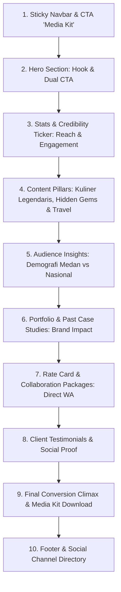

# EXECUTION PLAN (PLAN.md): LANDING PAGE KULINER & TRAVEL MEDAN
> **Target**: Panduan implementasi presisi langkah-demi-langkah bagi **AI Coding Agent** (Local Development) untuk menerjemahkan desain Google Stitch menjadi kode produksi dengan **fidelity 100% konsisten**, responsif, dan teroptimasi untuk konversi brand collaboration & Media Kit.

---

## 1. IKHTISAR PROYEK & TUJUAN BISNIS

### 1.1 Profil Niche & Value Proposition
- **Niche**: Kuliner & Travel Kota Medan (Heritage, Street Food, Halal/Non-halal Discovery, Destinasi Wisata Medan-Sumut).
- **Peran**: Digital Creator / Media Publikasi Hyperlocal Medan dengan pengaruh kuat pada keputusan kuliner dan travel audiens lokal serta wisatawan.
- **Tujuan Utama (Conversion Goals)**:
  1. **Primary**: Menghasilkan *inbound lead* untuk kolaborasi berbayar (endorsement, review resto, visit hotel, liputan event kuliner) via WhatsApp.
  2. **Secondary**: Memberikan akses instan atau unduhan **Media Kit lengkap** (Rate card, audiens demografi, insights, portfolio) bagi Brand Manager dan PR Agency.

### 1.2 Sumber Desain & Prinsip "Zero Drift" dari Google Stitch
- Desain acuan berasal dari **Google Stitch UI** (layout, hierarki visual, token warna, typography, dan micro-spacing).
- **Aturan Baku AI Agent**:
  - Dilarang mengganti skema warna hex Stitch dengan warna generik.
  - Dilarang mengubah rasio padding/margin Stitch.
  - Komponen harus dipecah secara modular (clean architecture).
  - Teks tidak boleh menggunakan *Lorem Ipsum*; gunakan copy copywriting spesifik kuliner & travel Medan yang telah disiapkan di file data.

---

## 2. ARSITEKTUR TEKNOLOGI & SYSTEM SETUP

### 2.1 Technology Stack Rekomendasi
| Layer | Teknologi | Alasan Pemilihan |
| :--- | :--- | :--- |
| **Framework** | **Vite + React (TypeScript)** *(atau Next.js App Router)* | Cepat di-build, performa tinggi, ringan untuk single-page landing |
| **Styling** | **Tailwind CSS v3.4+** | Translasi langsung dari utility classes Google Stitch |
| **Icons** | **Lucide React** | Ikon clean, modern, konsisten dengan standar UI Stitch |
| **Micro-Interactions** | **Framer Motion** | Animasi smooth fade-in, bento-grid hover, dan modal transition |
| **Typography** | **Google Fonts** (`Outfit` / `Plus Jakarta Sans`) | Tipografi modern dengan kontras tinggi untuk judul & kenyamanan baca |
| **Asset Delivery** | WebP / SVG lokal | Loading ultra-cepat (< 1.5 detik First Contentful Paint) |

### 2.2 Struktur Direktori Target
AI Coding Agent harus menyusun file project mengikuti struktur berikut:

```
wandeslub-landing/
├── public/
│   ├── favicon.ico
│   ├── og-medan-travel.jpg
│   └── media-kit-preview.pdf (placeholder/dokumen media kit)
├── src/
│   ├── assets/
│   │   ├── images/
│   │   │   ├── hero-bg.webp
│   │   │   ├── creator-profile.webp
│   │   │   ├── culinary-1.webp (Soto Medan / Bihun Bebek)
│   │   │   ├── culinary-2.webp (Durian Ucok / Kesawan Night)
│   │   │   ├── travel-1.webp (Istana Maimun / Tjong A Fie)
│   │   │   └── travel-2.webp (Danau Toba / Berastagi Trip)
│   │   └── logos/
│   │       ├── brand-1.svg
│   │       └── brand-2.svg
│   ├── components/
│   │   ├── layout/
│   │   │   ├── Navbar.tsx
│   │   │   └── Footer.tsx
│   │   ├── sections/
│   │   │   ├── HeroSection.tsx
│   │   │   ├── StatsTicker.tsx
│   │   │   ├── ContentPillars.tsx
│   │   │   ├── AudienceInsights.tsx
│   │   │   ├── PortfolioShowcase.tsx
│   │   │   ├── PricingTiers.tsx
│   │   │   ├── Testimonials.tsx
│   │   │   └── FinalCta.tsx
│   │   └── ui/
│   │       ├── Button.tsx
│   │       ├── Badge.tsx
│   │       ├── Modal.tsx
│   │       ├── MediaKitModal.tsx
│   │       └── SectionWrapper.tsx
│   ├── data/
│   │   ├── content.ts       # Semua copy, metadata, statistik & review
│   │   └── config.ts        # Nomor WhatsApp, link sosial media, info brand
│   ├── types/
│   │   └── index.ts
│   ├── utils/
│   │   └── whatsapp.ts      # Generator URL WhatsApp dengan pre-filled template
│   ├── App.tsx
│   ├── main.tsx
│   └── index.css
├── index.html
├── tailwind.config.js
├── tsconfig.json
└── package.json
```

---

## 3. DESIGN SYSTEM & TOKEN MAPPING (STITCH TO TAILWIND)

AI Agent **wajib** mendaftarkan token berikut ke `tailwind.config.js` sebelum menulis komponen:

```javascript
// tailwind.config.js
/** @type {import('tailwindcss').Config} */
export default {
  content: [
    "./index.html",
    "./src/**/*.{js,ts,jsx,tsx}",
  ],
  theme: {
    extend: {
      colors: {
        brand: {
          // Warm Spice & Terracotta khas kuliner Medan
          primary: '#E23E1D',     // Tomat / Cabai Merah segar (Main CTA & Accents)
          primaryHover: '#C53214',
          secondary: '#D97706',   // Rempah Kunyit / Heritage Gold
          accent: '#F59E0B',      // Warm Sunshine / Durian Gold
          dark: '#121316',        // Deep Charcoal (Background & Text)
          surface: '#1A1C20',     // Surface Card Dark
          surfaceLight: '#FBFBFA',// Creamy Light Surface
          muted: '#71717A',       // Subtle Grey untuk secondary copy
          border: '#27272A',      // Dark Mode Divider
          borderLight: '#E4E4E7'  // Light Mode Divider
        }
      },
      fontFamily: {
        heading: ['Outfit', 'sans-serif'],
        body: ['Plus Jakarta Sans', 'sans-serif'],
        display: ['Playfair Display', 'serif'], // Aksen estetik warisan Medan
      },
      borderRadius: {
        'stitch-sm': '8px',
        'stitch-md': '14px',
        'stitch-lg': '20px',
        'stitch-xl': '28px',
        'stitch-full': '9999px',
      },
      boxShadow: {
        'stitch-card': '0 10px 30px -10px rgba(0, 0, 0, 0.08)',
        'stitch-glow': '0 0 25px -5px rgba(226, 62, 29, 0.35)',
        'stitch-float': '0 20px 40px -15px rgba(0, 0, 0, 0.15)',
      }
    },
  },
  plugins: [],
}
```

---

## 4. ANATOMI KONTEN & STRUKTUR HALAMAN

AI Agent harus menyusun 9 seksi berurutan dengan hierarki konversi yang ketat:



### 4.1 Rincian Konten Setiap Seksi

1. **Header / Navbar**:
   - Logo / Brand Name (e.g. `MEDAN BITES & TRAILS` / Personal Brand).
   - Menu Navigasi: *Tentang*, *Statistik*, *Portfolio*, *Paket Kolaborasi*.
   - Dual Button CTA: "Media Kit" (Buka Modal Preview) & "Kolaborasi" (Direct WhatsApp).
   - Mode: Sticky dengan efek Glassmorphism (`backdrop-blur-md bg-white/80 dark:bg-brand-dark/80`).

2. **Hero Section (Conversion Anchor)**:
   - **Badge**: `🔥 #1 Kuliner & Travel Creator di Medan`.
   - **Headline**: "Eksplorasi Rasa & Pesona Medan: Hubungkan Brand Anda dengan Ribuan Pecinta Kuliner & Wisata".
   - **Sub-headline**: "Membantu UMKM, restoran legendaris, hotel, dan brand travel menjangkau audiens autentik Medan dengan engagement organik tinggi".
   - **Dual Action Button**:
     - CTA Utama: `[Unduh Media Kit 2026]` (Memicu Modal/Download).
     - CTA Sekunder: `[Diskusi Ide Kampanye (WhatsApp)]` (Direct link dengan template pesan).
   - **Visual**: Grid komposit Stitch (Foto estetik mie balap/soto medan, durian, dan panorama Danau Toba dengan float card statistik "94% Local Trust").

3. **Stats & Trust Ticker (Quick Proof)**:
   - Metrik 1: **500K+** Monthly Reach / Impressions.
   - Metrik 2: **8.2%** Average Engagement Rate (3x industri rata-rata).
   - Metrik 3: **150+** Resto, Cafe & Hotel Ter-review.
   - Metrik 4: **72%** Audiens Berdomisili Medan & Sumatra Utara.

4. **Pilar Konten Utama (Niche Specialization)**:
   - Bento-Grid Layout (mengikuti desain Stitch):
     - *Card 1*: **Street Food & Kuliner Legendaris** (Kesawan, Selat Panjang, Pasar Ramai).
     - *Card 2*: **Cafe & Modern Eateries** (Coffee shop culture, pastry, ambience review).
     - *Card 3*: **Travel & Staycation** (Boutique hotel Medan, weekend escape Berastagi, Toba).
     - *Card 4*: **Halal & Culinary Heritage Guide** (Eksplorasi resep peranakan & melayu).

5. **Audience Demographics (Why Brands Choose Us)**:
   - Data visual / Progress bar:
     - Usia: 18–34 tahun (84% segmen produktif & berdaya beli).
     - Gender: 54% Female, 46% Male.
     - Geografi: 68% Medan Kota, 18% Jabodetabek (Wisatawan), 14% Kota Lain di Sumatra.
   - Keunggulan: *High Buying Intent*, ulasan jujur & visual sinematik.

6. **Portfolio & Case Studies**:
   - Showcase 3 studi kasus nyata:
     - *Studi Kasus 1*: "Peluncuran Menu Baru Resto Seafood Medan" -> *Hasil: 1.2M Views, Antrian +350% di minggu pertama*.
     - *Studi Kasus 2*: "Staycation Experience Boutique Heritage Hotel" -> *Hasil: 850 Dm inquiry & 95% occupancy weekend*.
     - *Studi Kasus 3*: "Promosi Oleh-Oleh Khas Medan" -> *Hasil: Lonjakan pesanan online dari wisatawan luar kota*.

7. **Paket Kolaborasi & Rate Card (Pricing Table)**:
   - 3 Tier Card terstruktur:
     - **Tier 1: Foodie Spotlight (Single Review)**
       - 1x IG Reels / TikTok Video (Durasi 60-90s, High-Res 4K).
       - 3x IG Story dengan direct location & link order.
       - Google Maps Review & Local Guide Badge.
       - Button CTA: *Pilih Paket Foodie*.
     - **Tier 2: Ultimate Brand Campaign (Paling Populer / Featured Stitch Card)**
       - 2x Video Multi-Platform (Reels + TikTok + YouTube Shorts).
       - Dedicated Highlights "Rekomendasi Kuliner Medan".
       - Pin Post selama 14 Hari di profil.
       - Hak pakai video untuk Digital Ads Brand (30 hari).
       - Button CTA: *Konsultasikan Kampanye Ini*.
     - **Tier 3: Travel & Hospitality Experience**
       - 1x Full Staycation Vlog / Comprehensive Review.
       - Liputan fasilitas, kamar, sarapan & atraksi sekitar.
       - High-Resolution Photo Library (10 curated photos untuk brand).
       - Button CTA: *Book Jadwal Visit*.

8. **Testimoni & Brand Partners**:
   - Testimoni dari Owner Cafe/Resto lokal Medan & Marketing Manager Hotel.
   - Grid logo brand yang pernah bekerja sama.

9. **Interactive Media Kit Modal & Gated Download Flow**:
   - Modal pop-up modern: Menampilkan ringkasan visual Media Kit.
   - Form ringan: Nama Brand + Nomor WhatsApp/Email -> Tombol *Akses File PDF Media Kit Langsung*.

10. **Final CTA & Footer**:
    - Headline: "Punya Menu Juara atau Destinasi Seru di Medan? Mari Buat Publik Jatuh Cinta."
    - Fast Action WhatsApp Button.
    - Jam operasional kontak, alamat domisili Medan, email resmi tim management.

---

## 5. LANGKAH-DEMI-LANGKAH IMPLEMENTASI AI CODING AGENT

AI Coding Agent harus mengeksekusi instruksi ini secara bertahap tanpa melompati fase:

### FASE 1: Project Scaffolding & Setup Environment
1. Jalankan perintah inisialisasi:
   ```bash
   npm create vite@latest wandeslub-landing -- --template react-ts
   cd wandeslub-landing
   npm install
   ```
2. Pasang dependensi esensial:
   ```bash
   npm install lucide-react framer-motion clsx tailwind-merge canvas-confetti
   npm install -D @types/canvas-confetti tailwindcss postcss autoprefixer
   npx tailwindcss init -p
   ```
3. Konfigurasi `index.html`:
   - Pasang Google Fonts:
     ```html
     <link rel="preconnect" href="https://fonts.googleapis.com">
     <link rel="preconnect" href="https://fonts.gstatic.com" crossorigin>
     <link href="https://fonts.googleapis.com/css2?family=Outfit:wght@400;500;600;700;800&family=Playfair+Display:ital,wght@0,600;0,700;1,400&family=Plus+Jakarta+Sans:wght@400;500;600;700&display=swap" rel="stylesheet">
     ```
   - Atur Title & Meta Description SEO Kuliner Medan:
     ```html
     <title>Medan Culinary & Travel Creator | Brand Collaboration & Media Kit</title>
     <meta name="description" content="Portal kolaborasi resmi kreator kuliner & wisata Medan. Unduh Media Kit 2026, lihat rate card, data audiens, dan portofolio promosi resto & hotel.">
     ```

### FASE 2: Sinkronisasi Token Desain Stitch ke Tailwind
1. Tulis `tailwind.config.js` sesuai dengan token spesifikasi pada **Bagian 3**.
2. Tulis `src/index.css`:
   ```css
   @tailwind base;
   @tailwind components;
   @tailwind utilities;

   @layer base {
     html {
       scroll-behavior: smooth;
       font-family: 'Plus Jakarta Sans', sans-serif;
     }
     body {
       @apply bg-[#0D0E11] text-[#F3F4F6] antialiased selection:bg-brand-primary selection:text-white;
     }
     h1, h2, h3, h4 {
       font-family: 'Outfit', sans-serif;
     }
   }
   ```

### FASE 3: Penyusunan Data Source & State Management
AI Agent membuat file `src/data/content.ts` agar seluruh copy teks terpusat dan tidak di-hardcode:
1. Data profil, follower stats, dan demografi.
2. Data daftar portofolio kuliner & wisata (judul, gambar, metriks dampak).
3. Data paket kolaborasi (fitur, harga/keterangan "Mulai dari", link pesan otomatis).
4. Data testimoni klien brand.
5. Pembuatan utility `src/utils/whatsapp.ts`:
   ```typescript
   export const generateWhatsAppLink = (message: string): string => {
     const phone = "6281234567890"; // Ganti dengan nomor WhatsApp pemilik
     const encodedMessage = encodeURIComponent(message);
     return `https://wa.me/${phone}?text=${encodedMessage}`;
   };
   ```

### FASE 4: Pembuatan Komponen Atomik UI (Sesuai Stitch Specs)
AI Agent membuat file UI yang reusable:
1. `src/components/ui/Button.tsx`: Mendukung varian `primary` (merah cabai/stitch glow), `secondary` (amber/gold), `outline`, dan `ghost`.
2. `src/components/ui/Badge.tsx`: Tag kecil untuk kategori "Kuliner Legendaris", "Travel Spot", "Paling Diminati".
3. `src/components/ui/Modal.tsx`: Dialog overlay dengan animasi fade-in Framer Motion dan backdrop blur.
4. `src/components/ui/MediaKitModal.tsx`: Komponen khusus untuk download/baca Media Kit dengan input ringkas atau one-click download.

### FASE 5: Perakitan Komponen Seksi (Assembly)
AI Agent merakit setiap seksi satu per satu:
1. **`Navbar.tsx`**:
   - Tampilkan brand name / logo di sisi kiri.
   - Anchor links di tengah (hidden di mobile, drawer menu di mobile).
   - Tombol "Media Kit" & "WhatsApp Collab" di sisi kanan.
2. **`HeroSection.tsx`**:
   - Hero headline besar dengan aksen gradient text pada kata *Medan*.
   - Micro-badge verified creator.
   - Dual CTA yang kontras.
   - Grid gambar kuliner khas Medan (Soto, Durian, Mie Balap) dengan efek layering Stitch.
3. **`StatsTicker.tsx`**:
   - Grid 4 kolom menampilkan metrik performa dengan angka tebal dan label ringkas.
4. **`ContentPillars.tsx`**:
   - Bento-box cards dengan background image subtle, gradient overlay hitam, dan deskripsi pilar liputan.
5. **`AudienceInsights.tsx`**:
   - Card interaktif menampilkan bar demografi usia dan diagram sebaran geografis (Medan vs Luar Kota).
6. **`PortfolioShowcase.tsx`**:
   - Card proyek dengan badge brand, metrik views/reach, dan visual sebelum-sesudah/highlight video.
7. **`PricingTiers.tsx`**:
   - Tiga kartu paket kolaborasi. Kartu tengah (*Tier 2*) dibuat menonjol dengan border warna brand dan tag "Paling Direkomendasikan".
   - Setiap tombol paket langsung memanggil `generateWhatsAppLink("Halo, saya ingin reservasi Paket [Nama Paket]...")`.
8. **`Testimonials.tsx`**:
   - Carousel atau 3-card grid ulasan pemilik resto lokal & hotel.
9. **`FinalCta.tsx` & `Footer.tsx`**:
   - Penutup dengan kontras tinggi yang mengajak brand langsung menghubungi kreator.

### FASE 6: Integrasi Alur Konversi & Modal Media Kit
1. Pasang event listener saat pengunjung mengklik tombol **"Unduh Media Kit"**:
   - Munculkan `MediaKitModal`.
   - Pengunjung dapat melihat pratinjau slide Media Kit (Rate card, audiens sheet) atau langsung mengunduh file PDF.
   - Trigger efek kembang api/celebration (`canvas-confetti`) opsional saat formulir dikirim/diunduh untuk meningkatkan rasa puas pengunjung.

### FASE 7: Audit Konsistensi Stitch (Quality Assurance Checklist)
AI Agent wajib memverifikasi checklist berikut sebelum menyelesaikan tugas:
- [ ] **Color Accuracy**: Apakah kode hex merah (`#E23E1D`), amber (`#F59E0B`), dan latar gelap identik dengan Stitch?
- [ ] **Typography Hierarchy**: Apakah heading menggunakan font `Outfit` dan body menggunakan `Plus Jakarta Sans`?
- [ ] **Mobile Responsiveness**:
  - Tampilan di layar 375px (iPhone) tidak ada overflow horizontal (`overflow-x: hidden`).
  - Grid 3 atau 4 kolom berubah menjadi 1 kolom pada mobile secara mulus.
  - Sticky CTA bar di bagian bawah layar mobile (opsional) untuk mempermudah tap WhatsApp.
- [ ] **CTA Functionality**:
  - Tombol WhatsApp membuka tab baru dengan URL `https://wa.me/...` dan teks yang sudah di-encode rapi.
  - Tombol "Media Kit" membuka modal dan tidak menyebabkan layout bergeser (layout shift).
- [ ] **Media Optimization**:
  - Seluruh gambar kuliner dan travel menggunakan format WebP dengan alt text deskriptif untuk SEO lokal Medan.

### FASE 8: Build & Verifikasi Akhir
Jalankan perintah pengujian:
```bash
npm run build
npm run preview
```
Pastikan build sukses tanpa ada error TypeScript atau peringatan Tailwind yang terlewat.

---

## 6. PROMPT INSTRUKSI KHUSUS UNTUK AI CODING AGENT

AI Coding Agent dapat diberi prompt perintah langsung berikut saat eksekusi:

```text
"Anda adalah Senior Frontend Engineer & UI Specialist. Tugas Anda adalah membangun landing page 'Kuliner & Travel Medan' sesuai dengan dokumen PLAN.md di atas.

Instruksi Wajib:
1. Terapkan tech stack Vite + React + TypeScript + Tailwind CSS.
2. Gunakan token warna, tipografi, dan padding yang ada di tailwind.config.js PLAN.md agar 100% konsisten dengan desain Google Stitch.
3. Gunakan copy tulisan autentik seputar kuliner Medan (Soto Medan, Durian, Mie Aceh, Kesawan) dari data/content.ts, BUKAN teks placeholder.
4. Buat seluruh interaksi berfungsi: Modal Media Kit yang membuka dokumen/pratinjau, dan tombol WhatsApp dengan template pesan pre-filled.
5. Pastikan halaman 100% responsif di mobile (375px), tablet (768px), dan desktop (1280px+).
6. Jalankan 'npm run build' di akhir untuk membuktikan tidak ada error sintaks atau type mismatch."
```

---

## 7. HASIL AKHIR YANG DIHARAPKAN (DEFINITION OF DONE)
1. Repository lokal terstruktur bersih dengan komponen modular di `src/components/`.
2. Halaman tampil dengan visual identik 100% terhadap estetika desain Google Stitch (dark mode bernuansa hangat kuliner Medan).
3. Dua jalur konversi utama bekerja tanpa cela:
   - Akses & download Media Kit berfungsi.
   - WhatsApp link mengarahkan chat ke nomor creator dengan pesan instan.
4. Nilai performa Google Lighthouse: Performance > 90, SEO > 95, Accessibility > 95.
